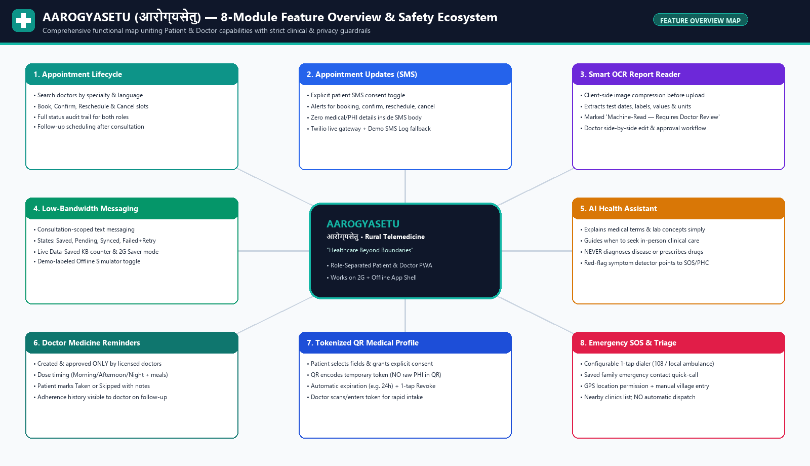
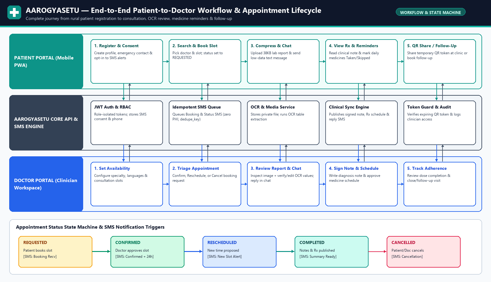
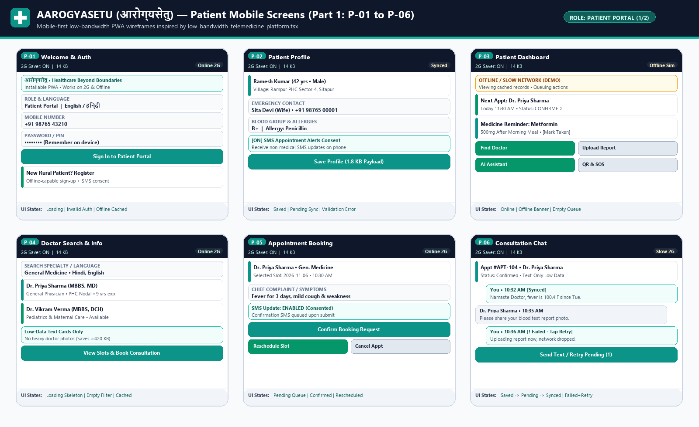
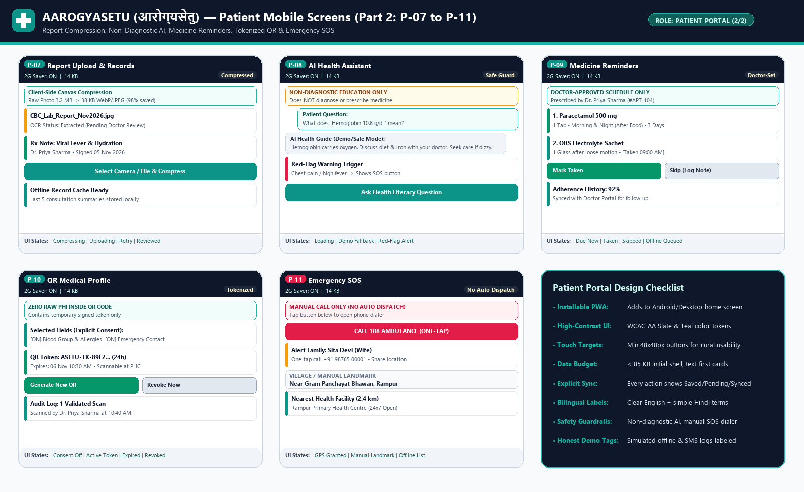
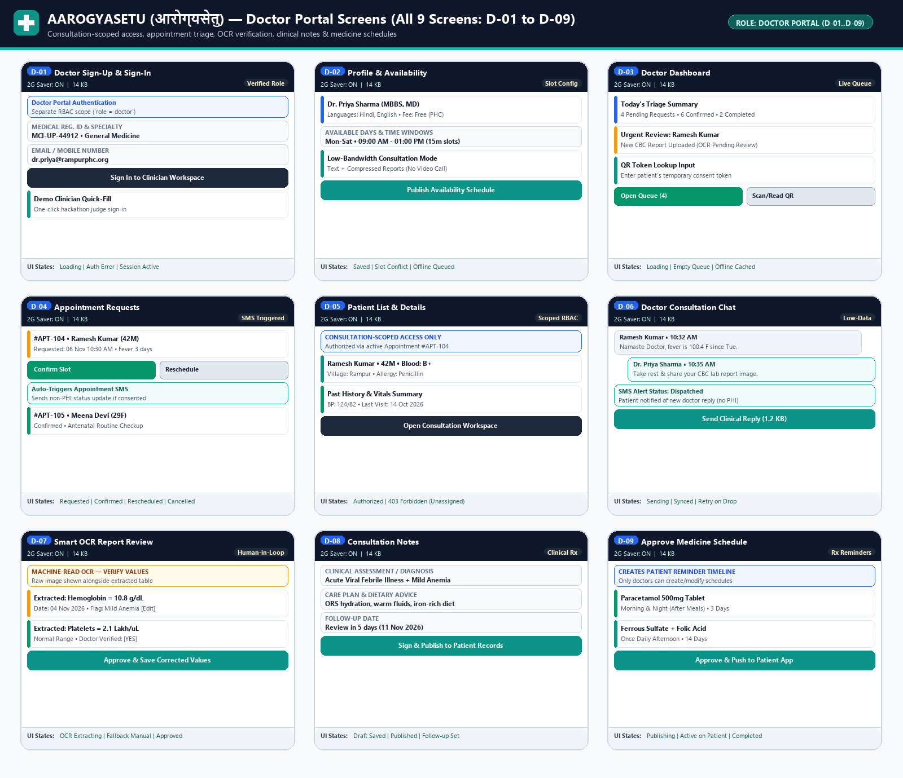
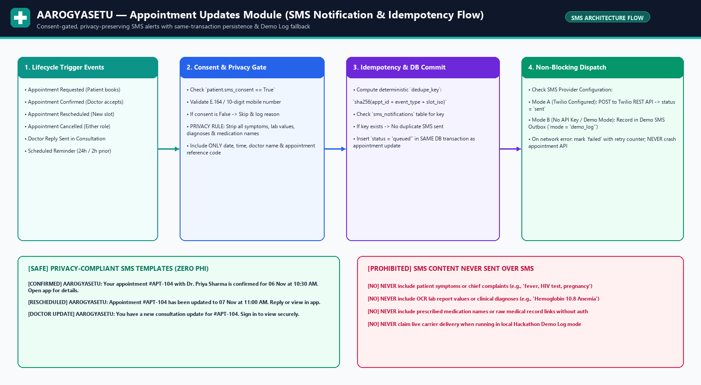
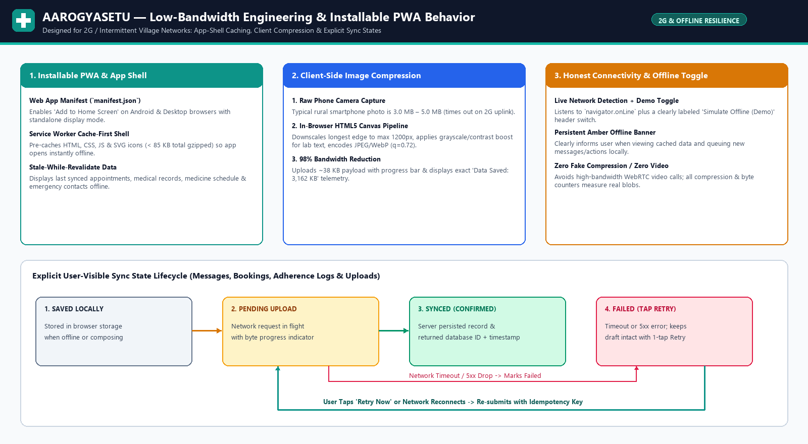
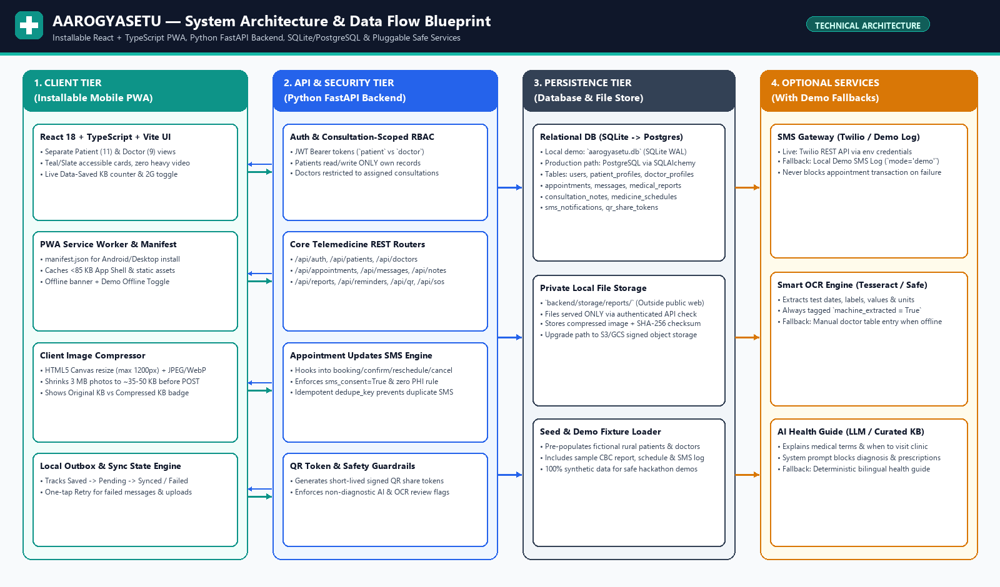

# AAROGYASETU (आरोग्यसेतु)
### “Healthcare Beyond Boundaries”
**Complete Visual Project & Technical Development Blueprint for an Installable, Low-Bandwidth Rural Telemedicine Progressive Web App (PWA)**

---

## How to Use This Blueprint (Recommended Build Order for Beginners & Hackathon Teams)

This blueprint is organized so a beginner or a 4-person hackathon team can take **AAROGYASETU (आरोग्यसेतु)** from design to a working, demo-ready prototype without getting overwhelmed. Follow these **6 sequential build stages**:

1. **Stage 1 — Foundation, Database & Role Authentication (0:00 – 0:40)**
   - Initialize the **Python FastAPI** backend (`backend/app/main.py`) and **SQLite** database (`aarogyasetu.db`).
   - Create the `users`, `patient_profiles`, and `doctor_profiles` tables and seed fictional rural demo accounts (`Ramesh Kumar` as Patient, `Dr. Priya Sharma` as Doctor).
   - Implement JWT authentication (`/api/auth/register`, `/api/auth/login`, `/api/auth/me`) and role-based route guards (`patient` vs. `doctor`).
2. **Stage 2 — App Shell, PWA Manifest & Low-Bandwidth UI Theme (0:40 – 1:15)**
   - Scaffold the **React + TypeScript (Vite)** frontend using the **Teal (`#0d9488`) and Slate (`#0f172a`)** visual system inspired by `low_bandwidth_telemedicine_platform.tsx`.
   - Add `public/manifest.json` and a lightweight Service Worker (`sw.js`) so the app is installable on mobile phones and desktop browsers and caches the `< 85 KB` app shell.
   - Build the persistent top status bar showing **Network Status (`Online 2G` / `Simulated Offline (Demo)`)**, **Data Saved KB Telemetry**, and the **Amber Offline Warning Banner**.
3. **Stage 3 — Core Appointment Lifecycle & Appointment Updates SMS Module (1:15 – 1:50)**
   - Build the Doctor directory, availability slot picker, and appointment booking endpoints (`/api/doctors`, `/api/appointments`).
   - Implement the **Appointment Updates Module** (`sms_notifications` table + idempotent `dedupe_key` queue) that triggers consent-gated, zero-PHI SMS alerts on **booking, confirmation, rescheduling, cancellation, reminders, and doctor replies**, automatically falling back to a clearly labeled **Demo SMS Log** when live Twilio credentials are not configured.
4. **Stage 4 — Consultation Messaging, Client Image Compression & Smart OCR Report Reader (1:50 – 2:20)**
   - Build consultation-scoped messaging (`/api/appointments/{id}/messages`) with explicit sync states (`Saved` -> `Pending` -> `Synced` / `Failed` with one-tap `Retry`).
   - Add the **HTML5 Canvas Client-Side Image Compressor** (shrinking 3 MB camera photos to ~38 KB JPEG/WebP before upload) and the **Smart Medical Report Reader (OCR)** with mandatory **Doctor Review & Correction** (`/api/reports/{id}/review`).
5. **Stage 5 — Clinical Notes, Doctor-Approved Medicine Reminders, QR Profile & Emergency SOS (2:20 – 2:45)**
   - Add Doctor consultation notes (`/api/appointments/{id}/notes`) and **Doctor-Approved Medicine Schedules** (`/api/reminders`) where doctors prescribe schedules and patients mark doses `Taken` or `Skipped`.
   - Implement the **Tokenized QR Medical Profile** (encoding only a short-lived signed token, never raw medical data) and **Emergency SOS** (one-tap `tel:108` dialer, saved emergency contact, manual village landmark fallback, and nearby clinics—with no automatic dispatch).
   - Add the **Non-Diagnostic AI Health Assistant** (`/api/assistant/ask`) with hard safety guardrails and an offline-capable educational fallback.
6. **Stage 6 — End-to-End Verification & 3-Minute Judge Walkthrough (2:45 – 3:00)**
   - Run through the dual-role Patient-to-Doctor demo script using fictional demo data to verify RBAC isolation, offline banner transitions, image compression telemetry, and SMS outbox logs.

---

## 1. Project Overview

### 1.1 Identity & Branding
- **Project Name:** AAROGYASETU
- **Hindi Name:** आरोग्यसेतु *(Meaning: “The Bridge to Health and Wellness”)*
- **Tagline:** *“Healthcare Beyond Boundaries”*
- **Platform Type:** Installable Mobile-First Progressive Web App (PWA) for smartphones and desktop browsers, backed by a lightweight REST API.
- **Visual Design Inspiration:** Derived from `low_bandwidth_telemedicine_platform.tsx` — combining a high-contrast **Slate-900 (`#0f172a`)** navigation header, **Teal-600 (`#0d9488`)** clinical action cards, **Emerald-600 (`#059669`)** sync confirmation badges, **Amber-500 (`#f59e0b`)** offline/demo banners, and real-time **Data Saved (KB)** telemetry.


*Figure 1: AAROGYASETU (आरोग्यसेतु) 8-Module Feature Overview & Safety Ecosystem.*

### 1.2 The Rural Healthcare Access Problem
Over 65% of residents in rural and remote regions face three compounding barriers when seeking basic healthcare:
1. **Geographic Distance & Doctor Shortage:** Primary Health Centres (PHCs) and specialist doctors are often located 15–50 km away from villages, forcing families to lose a full day's daily-wage income and pay high transport costs even for routine follow-ups or lab report reviews.
2. **Fragile 2G / Intermittent Mobile Connectivity:** Mainstream commercial telemedicine platforms are built around high-bitrate video calls (`1.5 Mbps+`), multi-megabyte JavaScript bundles, and uncompressed `3–5 MB` smartphone camera uploads that time out or exhaust prepaid data packs on rural 2G/Edge networks.
3. **Fragmented Paper Records & Missed Follow-Ups:** Patients carry paper prescriptions and lab reports that fade or get misplaced, miss follow-up appointments when clinics reschedule slots without notification, and struggle to interpret medical terminology or multi-drug dosing schedules.

### 1.3 Proposed Solution
**AAROGYASETU (आरोग्यसेतु)** bridges the rural healthcare divide through a **low-bandwidth, text-and-compressed-media-first installable PWA** purpose-built for two distinct roles (**Patient** and **Doctor**):
- **Ultra-Light Installable PWA (`< 85 KB` App Shell):** Installs directly from Chrome/Edge onto a phone's home screen without app-store downloads, caches core screens and recent records for offline viewing, and uses text-first cards instead of video streaming.
- **Client-Side Image Compression (`~98%` Data Reduction):** Compresses `3.2 MB` phone camera photos of lab reports down to `~38 KB` directly in the browser before uploading over slow rural connections.
- **Explicit Sync State Machine & Retry Resilience:** Every message, report upload, booking, and medicine log displays a clear state (`Saved`, `Pending`, `Synced`, or `Failed — Tap to Retry`) so unstable network drops never lose user input.
- **Consent-Gated SMS Appointment Updates:** Keeps rural patients informed of booking confirmations, reschedules, cancellations, reminders, and doctor replies via basic SMS—containing zero sensitive medical details—with a transparent Demo SMS Log fallback for offline/hackathon testing.
- **Clinician-Controlled Safety Loop:** Pairs smart productivity tools (**Smart OCR Report Reader**, **Doctor-Approved Medicine Reminders**, **Tokenized QR Medical Profile**, **Non-Diagnostic AI Health Assistant**, and **Emergency SOS**) with strict human-in-the-loop doctor verification and consultation-scoped access control.

### 1.4 Intended Users & Expected Benefits

| User Group | Primary Characteristics & Constraints | Expected Benefits from AAROGYASETU |
| :--- | :--- | :--- |
| **1. Rural Patients & Families** | Residents of villages/remote towns using entry-level Android smartphones on intermittent 2G/3G networks; bilingual (English/Hindi) needs; limited data balance. | • Book verified doctors without traveling 30 km.<br>• Upload lab reports using `< 50 KB` of mobile data.<br>• Receive SMS alerts for slot confirmations & changes.<br>• View doctor-approved medicine schedules & past records offline.<br>• Share a temporary consented QR token at clinics. |
| **2. PHC & Tele-Consult Doctors** | Doctors at Primary Health Centres, district hospitals, or NGO clinics managing high patient volumes across mobile or desktop browsers. | • Structured triage queue (`Requested`, `Confirmed`, `Rescheduled`).<br>• Side-by-side OCR lab report table with 1-click verification.<br>• Fast clinical note & medicine schedule publishing.<br>• Automatic non-PHI SMS notifications sent to patients.<br>• Consultation-scoped access to relevant patient history. |

---

## 2. Scope and User Journeys

### 2.1 Patient End-to-End Scope & Journey
1. **Registration & Profile Setup:** The patient opens AAROGYASETU (or installs it to their phone home screen), registers an account (`role = patient`), fills out their rural profile (name, age/DOB, gender, village/town, blood group, allergies, chronic conditions, and emergency contact), and explicitly toggles **SMS Appointment Updates Consent**.
2. **Doctor Search & Discovery:** The patient browses available doctors filtered by specialty (e.g., *General Medicine*, *Pediatrics*, *Maternal Care*) and language (*Hindi*, *English*), rendered as lightweight text cards without heavy portrait photos.
3. **Appointment Booking & Status Tracking:** The patient selects an available date/time slot, enters their chief complaint, and submits a booking (`status = requested`). If SMS consent is active, an immediate booking-received SMS notification is queued. The patient can also request a **reschedule** or **cancellation**.
4. **Consultation Messaging & Compressed Report Upload:** Inside the appointment consultation workspace, the patient exchanges low-bandwidth text messages with the assigned doctor and uploads a smartphone photo of a medical report. The browser compresses the image (`3.2 MB -> 38 KB`) before upload, and the backend extracts candidate test values via OCR.
5. **Viewing Records, Medicine Reminders & AI Education:** Once the doctor signs the consultation note and approves a medicine schedule, the patient views their clinical summary (cached for offline reading), marks daily medicine doses as `Taken` or `Skipped`, asks general non-diagnostic health literacy questions in the **AI Health Assistant**, generates a temporary consented **QR Medical Profile token** for clinic visits, or uses the **Emergency SOS** screen to place a one-tap call to `108` or their family contact.

### 2.2 Doctor End-to-End Scope & Journey
1. **Registration, Sign-In & Availability Setup:** The clinician signs into the dedicated **Doctor Portal** (`role = doctor`), configures their medical registration number, specialty, spoken languages, and weekly availability windows.
2. **Appointment Triage & Status Management:** From the Doctor Dashboard and Appointment Requests screen, the doctor reviews incoming `requested` consultations and **Confirms**, **Reschedules** (proposing a new date/time with reason), or **Cancels** them. Each status transition automatically triggers an idempotent, non-PHI SMS update for consented patients.
3. **Scoped Patient Review & Consultation Messaging:** The doctor opens the assigned patient's clinical summary (strictly scoped by RBAC to patients with whom the doctor has an assigned consultation) and replies to the patient's messages in real time or asynchronous low-data mode.
4. **Smart Medical Report Review (OCR Verification):** The doctor opens the patient's uploaded lab report image alongside the machine-extracted OCR values (test date, parameter label, value, unit, and flag), corrects any misread characters, and marks the report **Doctor Reviewed**.
5. **Consultation Notes, Medicine Schedule & Follow-Up:** The doctor writes a structured clinical note (assessment, care advice, red-flag warnings, follow-up date), publishes a **Doctor-Approved Medicine Schedule** (which immediately populates the patient's Medicine Reminders screen), and marks the consultation `completed` or schedules a `follow_up`.

### 2.3 Complete Patient-to-Doctor Workflow & Appointment Status Diagram


*Figure 2: End-to-End Patient-to-Doctor Swimlane Workflow & Appointment Status State Machine.*

---

## 3. App Interfaces (Mobile-First Screen Designs & Specifications)

All 20 screens (**11 Patient Portal screens** and **9 Doctor Portal screens**) share a unified, accessible mobile-first visual system inspired by `low_bandwidth_telemedicine_platform.tsx`:
- **Persistent Top Telemetry Bar:** Displays Role Badge (`Patient` / `Doctor`), Network Status Pill (`Online 2G` / `Simulated Offline (Demo)`), `2G Data Saver: ON`, and `Data Saved: X KB`.
- **High-Contrast Typography & Touch Targets:** Minimum `48x48 px` touch buttons, clear English + Hindi section headings, and explicit status badges (`Saved`, `Pending`, `Synced`, `Failed — Tap Retry`).

### 3.1 Patient Portal Mobile Screens (`P-01` to `P-11`)


*Figure 3A: Patient Mobile Wireframes Part 1 — Welcome & Auth (P-01), Patient Profile (P-02), Patient Dashboard (P-03), Doctor Search & Details (P-04), Appointment Booking & Details (P-05), and Consultation Messaging (P-06).*


*Figure 3B: Patient Mobile Wireframes Part 2 — Report Upload & Medical Records (P-07), AI Health Assistant (P-08), Medicine Reminders (P-09), QR Medical Profile & Consent (P-10), and Emergency SOS (P-11).*

#### Detailed Specification of All 11 Patient Screens

| ID & Screen Name | Purpose | Main UI Elements | Primary User Actions | Important UI States (`Loading`, `Empty`, `Offline`, `Pending`, `Success`, `Error`) |
| :--- | :--- | :--- | :--- | :--- |
| **P-01: Welcome, Sign-Up & Sign-In** | Entry point for rural patients with role selection, PWA install prompt, and fast credential login/registration. | • Brand header (`AAROGYASETU / आरोग्यसेतु`)<br>• Role selector tab (`Patient` vs `Doctor`)<br>• Phone/Email + Password/PIN inputs<br>• "Install App to Home Screen" banner<br>• Demo Account 1-Tap Quick-Fill button | • Sign in with phone & password<br>• Switch to New Patient Sign-Up form<br>• Trigger browser PWA install prompt<br>• Fill demo patient (`Ramesh Kumar`) | • **Loading:** Disables submit button (`Signing in...`)<br>• **Empty:** Highlights required phone/password fields<br>• **Offline:** Allows viewing cached emergency/SOS info; disables new registration with clear notice<br>• **Pending:** Shows token exchange spinner<br>• **Success:** Redirects to `P-03` Dashboard<br>• **Error:** High-contrast rose banner (`Invalid phone or password — tap to retry`) |
| **P-02: Patient Profile & Consent** | Capture demographic, village, medical baseline, emergency contact, and SMS notification consent. | • Full Name, Age/DOB, Gender inputs<br>• Phone Number & Optional Email<br>• Village/Town/Block & District fields<br>• Blood Group, Known Allergies, Chronic Conditions<br>• Emergency Contact Name, Relation & Phone<br>• **SMS Appointment Alerts Consent Toggle** | • Edit profile fields<br>• Toggle SMS consent `ON` or `OFF`<br>• Save profile updates (`1.8 KB` JSON payload) | • **Loading:** Skeleton input placeholders<br>• **Empty:** Prompts newly registered user to complete emergency contact & village<br>• **Offline:** Saves draft locally (`Saved Locally — Will sync when online`)<br>• **Pending:** Shows `Saving (1.8 KB)...`<br>• **Success:** Emerald badge (`Profile Synced`)<br>• **Error:** Field-level phone validation or retry button |
| **P-03: Patient Dashboard** | Central low-bandwidth command center showing next appointment, due medicines, network state, and quick actions. | • Amber **Offline / Slow Network Banner** (when offline)<br>• Data-Saved KB counter card<br>• Next Upcoming Appointment summary card<br>• Due Medicine Reminder quick-action card<br>• 2x2 grid: *Find Doctor*, *Upload Report*, *AI Health Guide*, *QR & Emergency SOS* | • Open active appointment chat<br>• Mark due medicine dose as `Taken`<br>• Toggle *Simulate Offline (Demo)* mode<br>• Navigate to any of the 11 patient modules | • **Loading:** Lightweight text-line placeholders<br>• **Empty:** Welcomes new patient with a *Book Your First Consultation* CTA<br>• **Offline:** Displays Amber banner (`Viewing cached records • Queuing actions`)<br>• **Pending:** Shows count of queued offline items (`1 Pending Sync`)<br>• **Success:** Shows green `All Records Synced` pill<br>• **Error:** Shows `Sync Failed — Tap to Retry All` banner |
| **P-04: Doctor Search & Doctor Details** | Help patients discover available clinicians by specialty, language, and schedule without heavy images. | • Specialty filter chips (*General Medicine*, *Pediatrics*, *Maternal Health*)<br>• Language filter (*Hindi*, *English*)<br>• Text-only Doctor Cards (Name, Qualification, PHC/Clinic, Languages, Next Available Slot)<br>• Expandable Doctor Details drawer | • Filter doctors by specialty or language<br>• Inspect doctor qualifications & available time windows<br>• Tap *Select Slot & Book* | • **Loading:** Text card outlines (`Loading doctor directory...`)<br>• **Empty:** `No doctors match this filter — tap Reset Filters`<br>• **Offline:** Serves last cached doctor directory from IndexedDB/localStorage<br>• **Pending:** Refreshing availability slots indicator<br>• **Success:** Renders verified doctor list with byte-size badge<br>• **Error:** `Could not refresh directory — showing cached list + Retry` |
| **P-05: Appointment Booking & Details** | Book a new consultation slot or view, reschedule, or cancel an existing appointment. | • Selected Doctor summary header<br>• Date picker & 15-minute Available Slot chips<br>• Chief Complaint / Symptoms text box<br>• SMS Consent confirmation status strip<br>• Existing Appointment Status timeline (`Requested` -> `Confirmed` / `Rescheduled` / `Cancelled`)<br>• *Reschedule* and *Cancel* buttons | • Pick date/time & submit booking<br>• Propose new slot to reschedule<br>• Cancel appointment with reason<br>• View SMS Notification Log for this appointment | • **Loading:** Fetching open slots for selected date<br>• **Empty:** `No slots left on this date — select next available day`<br>• **Offline:** Saves booking draft locally (`Saved Offline — tap Sync when connected`)<br>• **Pending:** `Submitting booking request...`<br>• **Success:** `Appointment #APT-104 Requested! SMS confirmation queued.`<br>• **Error:** `Slot was just taken or network timed out — pick another slot / Retry` |
| **P-06: Consultation Messaging** | Asynchronous and live text-first messaging between the patient and assigned doctor inside an appointment. | • Appointment header (`#APT-104 • Dr. Priya Sharma`)<br>• Message thread bubbles with timestamps<br>• Per-message delivery state badge (`Saved`, `Pending`, `Synced`, `Failed`)<br>• Quick symptom template chips<br>• Text input bar + *Send* + *Retry Failed* button | • Type and send text message to doctor<br>• Tap *Retry* on any failed message<br>• Jump to attached medical reports or clinical notes | • **Loading:** Loading consultation history<br>• **Empty:** `No messages yet — describe your symptoms to Dr. Priya Sharma`<br>• **Offline:** Queues outgoing message (`Saved Locally — Pending Network`)<br>• **Pending:** Amber clock badge (`Sending 0.6 KB...`)<br>• **Success:** Emerald check (`Synced 10:32 AM`)<br>• **Error:** Rose badge (`! Failed — Tap to Retry`) keeping message text intact |
| **P-07: Report Upload & Medical Records** | Compress medical images client-side before upload, view OCR extracted values, and read doctor consultation notes. | • File/Camera picker (`JPG, PNG, WebP`)<br>• **Client-Side Canvas Compression Preview** (`Original: 3,200 KB -> Compressed: 38 KB • 98% Saved`)<br>• Report list with OCR status (`Pending Doctor Review` vs `Doctor Verified`)<br>• Chronological Medical Records & Signed Clinical Notes list | • Select camera photo or lab image<br>• Preview compressed image & upload<br>• View OCR extracted table & doctor's verified corrections<br>• Read past consultation notes offline | • **Loading:** `Compressing image on device...` / `Loading records...`<br>• **Empty:** `No reports uploaded yet — tap Select Camera/File`<br>• **Offline:** Allows reading cached medical records & queuing report draft<br>• **Pending:** Progress bar (`Uploading 38 KB...`)<br>• **Success:** `Report uploaded & OCR extracted (Marked for Doctor Review)`<br>• **Error:** `Upload interrupted on slow network — Tap Retry (no re-selection needed)` |
| **P-08: AI Health Assistant** | Provide basic health literacy, plain-language explanations of medical terms, and guidance on when to seek care. | • Prominent Amber Safety Banner: **“Educational Only — Does NOT diagnose or prescribe medicine”**<br>• Question input box + suggested rural health prompts (*What is Hemoglobin?*, *ORS preparation*, *When to visit PHC for fever*)<br>• Structured answer card (*Plain Meaning*, *General Self-Care*, *When to See a Doctor*)<br>• Red-Flag Symptom Alert linking to Emergency SOS | • Ask a health education or lab-term question<br>• Tap a suggested topic chip<br>• Tap *Book Doctor* or *Open Emergency SOS* if experiencing red-flag symptoms | • **Loading:** `Fetching educational guide...`<br>• **Empty:** Shows starter health literacy cards (Hydration, Fever Care, Maternal Nutrition)<br>• **Offline:** Uses built-in **Offline Curated Health Literacy Knowledge Base (Demo/Safe Mode)**<br>• **Pending:** Processing question<br>• **Success:** Displays educational explanation + mandatory clinical disclaimer<br>• **Error:** Falls back gracefully to local curated health glossary |
| **P-09: Medicine Reminders** | Display doctor-approved medication schedules and allow the patient to track daily dose adherence. | • Header badge: **“Doctor-Approved Schedule Only”** (patients cannot self-prescribe)<br>• Daily timeline grouped by *Morning*, *Afternoon*, *Night*<br>• Medicine card (Drug name, strength, dosage instructions, meal timing, duration)<br>• *Mark Taken* and *Skip (with optional reason)* buttons<br>• Adherence percentage & history log | • Tap *Mark Taken* when a dose is consumed<br>• Tap *Skip* and select a reason (e.g., *Medicine finished*, *Felt nausea*)<br>• View past 7-day adherence log | • **Loading:** Loading active medicine schedules<br>• **Empty:** `No active medicine schedule. Schedules appear here once approved by your doctor.`<br>• **Offline:** Logs `Taken`/`Skipped` events in local queue for background sync<br>• **Pending:** `Syncing dose log...`<br>• **Success:** Updates card to `Taken at 09:05 AM [Synced]`<br>• **Error:** `Sync pending — stored on phone, tap Retry` |
| **P-10: QR Medical Profile & Consent** | Let patients share a subset of their medical profile at a clinic using a temporary, revocable tokenized QR code. | • Privacy Banner: **“QR contains a temporary secure token only — never raw medical data”**<br>• Checkboxes for patient-selected fields (*Basic Demographics*, *Blood Group & Allergies*, *Chronic Conditions*, *Emergency Contact*, *Recent Approved Notes*)<br>• Explicit Consent checkbox + Expiry selector (`1 Hour`, `24 Hours`, `7 Days`)<br>• Rendered SVG QR Code + human-readable shortcode (`ASETU-TK-...`)<br>• *Revoke Token Immediately* button | • Select which categories to share<br>• Grant consent & generate temporary QR token<br>• Show QR on screen or read out shortcode to doctor<br>• Revoke active token at any time | • **Loading:** `Generating cryptographic share token...`<br>• **Empty:** `No active QR token — select fields & grant consent to generate`<br>• **Offline:** Displays most recently generated unexpired QR SVG cached on device<br>• **Pending:** Requesting token or revocation<br>• **Success:** Displays scannable QR + live countdown timer (`Expires in 23h 59m`)<br>• **Error:** `Token expired or revoked — generate a new token` |
| **P-11: Emergency SOS** | Provide rapid, user-initiated access to emergency calling, family contact details, location entry, and nearby facilities. | • Rose Safety Notice: **“Manual Call Only — This app does NOT automatically dispatch emergency services”**<br>• Large 1-tap `CALL 108 AMBULANCE` (`tel:108`) button + configurable local emergency number<br>• Saved Emergency Contact card with 1-tap call (`tel:+91...`)<br>• Optional Browser GPS Location button + **Manual Village / Landmark text box**<br>• Nearby PHCs / District Hospitals directory card | • Tap to open phone dialer for `108` or local emergency helpline<br>• Tap to call saved family emergency contact<br>• Request optional GPS coordinates or type village landmark manually<br>• View nearest 24x7 PHC directions & phone number | • **Loading:** `Checking optional GPS coordinates...`<br>• **Empty:** Prompts user to type village/landmark if emergency contact is not yet saved<br>• **Offline:** **100% functional offline** — `tel:` dialer links, saved contact, manual landmark, and cached PHC list work without internet<br>• **Pending:** Requesting browser geolocation permission<br>• **Success:** Displays shareable location text (`Rampur Gram Panchayat, 26.76°N, 80.91°E`)<br>• **Error:** If GPS permission denied/unavailable, highlights **Manual Village Landmark** box immediately |

---

### 3.2 Doctor Portal Screens (`D-01` to `D-09`)


*Figure 4: Doctor Portal Mobile & Responsive Screens (All 9 Screens: D-01 to D-09).*

#### Detailed Specification of All 9 Doctor Screens

| ID & Screen Name | Purpose | Main UI Elements | Primary User Actions | Important UI States (`Loading`, `Empty`, `Offline`, `Pending`, `Success`, `Error`) |
| :--- | :--- | :--- | :--- | :--- |
| **D-01: Doctor Sign-Up & Sign-In** | Dedicated clinician authentication portal enforcing `role = doctor` separation. | • Clinician Portal badge (`Role: Doctor`)<br>• Email/Phone + Password inputs<br>• Doctor Registration tab (Full Name, Medical Council Reg. Number, Specialty, Hospital/PHC affiliation)<br>• 1-Click Demo Doctor Login (`Dr. Priya Sharma`) | • Sign in as verified doctor<br>• Register a new clinician account<br>• Switch to Patient Portal if clicked by mistake | • **Loading:** `Verifying clinician credentials...`<br>• **Empty:** Validates required Medical Reg. ID & password<br>• **Offline:** Shows cached clinician session if already authenticated<br>• **Pending:** Issuing role-scoped JWT<br>• **Success:** Opens `D-03` Doctor Dashboard<br>• **Error:** `Invalid clinician credentials or unauthorized role` |
| **D-02: Doctor Profile & Availability** | Allow doctors to manage their clinical profile, spoken languages, and bookable consultation time windows. | • Name, Qualifications (`MBBS, MD`), Reg. No., PHC/Clinic Name<br>• Spoken Languages checkboxes (*Hindi*, *English*, *Regional*)<br>• Weekly Availability Editor (Days, Start/End Time, Slot Duration)<br>• *Accepting Consultations* status toggle | • Update specialty, bio, and languages<br>• Add or remove available consultation slots<br>• Toggle availability `Active` / `Paused` | • **Loading:** Loading saved availability schedule<br>• **Empty:** Prompts new doctor to add their first consultation time window<br>• **Offline:** Queues profile edits in local draft state<br>• **Pending:** `Saving availability schedule...`<br>• **Success:** `Availability updated — visible to patients`<br>• **Error:** `Overlapping time window detected — please adjust times` |
| **D-03: Doctor Dashboard** | Provide an at-a-glance clinical triage overview of today's appointments, unread reports, and QR token lookup. | • Today's Queue Metrics (*Pending Requests*, *Confirmed*, *Completed*)<br>• Priority Action List (Appointments awaiting confirmation & reports awaiting OCR review)<br>• **Patient QR Token Lookup Box** (scan or type `ASETU-TK-...` token)<br>• Low-bandwidth telemetry strip | • Jump directly to pending appointment requests<br>• Open unreviewed lab reports<br>• Enter/scan a patient's temporary QR token to view consented summary | • **Loading:** Loading daily triage metrics<br>• **Empty:** `No appointments scheduled for today`<br>• **Offline:** Shows cached queue & amber offline indicator<br>• **Pending:** Refreshing live queue<br>• **Success:** Displays updated counts & last-synced timestamp<br>• **Error:** `Invalid or expired QR token` (when looking up a revoked/expired token) |
| **D-04: Appointment Requests & Management** | Let doctors triage incoming bookings and Confirm, Reschedule, or Cancel appointments with automatic SMS updates. | • Filter tabs (`Requested`, `Confirmed`, `Rescheduled`, `Completed`, `Cancelled`)<br>• Appointment Cards (Patient Name, Age/Gender, Village, Slot Time, Chief Complaint)<br>• Action buttons: **Confirm Slot**, **Reschedule (Pick New Date/Time)**, **Cancel**<br>• SMS Trigger Indicator badge (`SMS Consent: ON`) | • Approve (`Confirm`) a requested slot<br>• Propose a new date/time (`Reschedule`) with clinical note<br>• Cancel an appointment with reason<br>• Open consultation workspace | • **Loading:** Loading filtered appointment queue<br>• **Empty:** `No pending appointment requests in this tab`<br>• **Offline:** Queues status decision locally with `Pending Sync` badge<br>• **Pending:** `Updating status & queuing patient SMS...`<br>• **Success:** `Status -> CONFIRMED (Patient SMS queued in Demo/Live Log)`<br>• **Error:** `Update failed — tap Retry` |
| **D-05: Patient List & Patient Details** | Display patients assigned to the doctor and show their consultation-scoped clinical profile and history. | •RBAC Scope Banner: **“Consultation-Scoped Access Only”**<br>• Assigned Patient Directory (searchable by name or village)<br>• Patient Details View: Demographics, Village, Blood Group, Allergies, Chronic Conditions, Emergency Contact, Past Consultation Notes, Uploaded Reports, Adherence Rate | • Select an assigned patient to view their clinical history<br>• Review allergies & chronic conditions before prescribing<br>• Launch active consultation chat or report review | • **Loading:** Loading assigned patient summary<br>• **Empty:** `No assigned patients yet`<br>• **Offline:** Displays cached profiles of today's assigned patients<br>• **Pending:** Syncing latest patient vitals/records<br>• **Success:** Renders complete scoped profile<br>• **Error:** `403 Forbidden: You can only access patients assigned to your consultations` |
| **D-06: Consultation Messaging (Doctor View)** | Enable the doctor to communicate with the patient over low-bandwidth text and trigger reply notifications. | • Patient summary header (Name, Age, Allergies, Chief Complaint)<br>• Consultation message timeline<br>• Quick clinical phrase buttons (*Please upload lab report*, *Take rest & drink ORS*, *Visit PHC immediately if fever rises*)<br>• Reply composer + SMS notification status indicator | • Send clinical questions or guidance to the patient<br>• Insert quick bilingual clinical phrases<br>• Retry failed messages on slow connections | • **Loading:** Loading message thread<br>• **Empty:** `Start the consultation by messaging the patient`<br>• **Offline:** Saves doctor's reply locally (`Saved — Pending Sync`)<br>• **Pending:** `Sending reply (0.9 KB)...`<br>• **Success:** `Synced • Non-PHI SMS alert queued for patient`<br>• **Error:** `Message send failed — Tap Retry` |
| **D-07: Report Review & Extracted Text (Smart OCR)** | Present the patient's uploaded medical image alongside machine-extracted OCR values for mandatory doctor review. | • Amber Safety Banner: **“Machine-Read OCR May Be Incomplete — Requires Doctor Review”**<br>• Zoomable compressed report image (`38 KB`)<br>• Editable OCR Extracted Table (Test Date, Parameter Name, Extracted Value, Unit, Reference Flag)<br>• Doctor Review Notes box<br>• **Approve & Mark Doctor-Reviewed** button | • Compare raw report image with OCR-extracted rows<br>• Edit/correct any misread value or add missing parameters<br>• Add clinical interpretation note<br>• Mark report as `Doctor Reviewed` | • **Loading:** `Running OCR extraction on uploaded report...`<br>• **Empty (OCR Fallback):** `Automated OCR unavailable or image handwritten — enter key values manually below`<br>• **Offline:** Shows cached report image & saves doctor's edits locally<br>• **Pending:** `Saving verified lab values...`<br>• **Success:** Emerald badge (`Verified by Dr. Priya Sharma`) visible to patient<br>• **Error:** `Could not save review — Tap Retry` |
| **D-08: Consultation Notes** | Allow the doctor to author and sign structured clinical consultation notes that become part of the patient's medical record. | • Clinical Assessment / Working Impression input<br>• Care Plan & Dietary/Lifestyle Advice input<br>• Red-Flag Warning Symptoms to watch for<br>• Recommended Follow-Up Date picker<br>• *Mark Appointment Completed* checkbox + **Sign & Publish Note** button | • Draft structured consultation note<br>• Set follow-up date<br>• Sign and publish note to the patient's Medical Records (`P-07`) | • **Loading:** Loading existing notes for this appointment<br>• **Empty:** Clean clinical note template ready for entry<br>• **Offline:** Auto-saves clinical note draft in browser storage<br>• **Pending:** `Signing & publishing clinical note...`<br>• **Success:** `Consultation Note Signed & Published to Patient Record`<br>• **Error:** `Publish failed — draft preserved locally, tap Retry` |
| **D-09: Doctor-Approved Medicine Schedule** | Enable only authenticated doctors to create, edit, and approve structured medication reminder schedules for a patient. | • Authority Banner: **“Only Doctors Can Create or Approve Medicine Schedules”**<br>• Medicine Item Builder: Medicine Name, Dosage/Strength (e.g., `500 mg`), Timing slots (`Morning`, `Afternoon`, `Night`), Meal Relation (`Before Food` / `After Food`), Duration in Days, Special Instructions<br>• Patient Adherence Log viewer (`Taken` vs `Skipped` timestamps)<br>• **Approve & Push to Patient Reminders** button | • Add one or more medicines to the consultation schedule<br>• Approve & publish schedule to patient's `P-09` screen<br>• Review patient's dose completion/skip history during follow-up | • **Loading:** Loading patient's current medicine schedules & adherence logs<br>• **Empty:** `No active medicines prescribed for this consultation`<br>• **Offline:** Saves draft schedule locally until network reconnects<br>• **Pending:** `Publishing approved medicine schedule...`<br>• **Success:** `Approved Schedule Active on Patient App`<br>• **Error:** `Validation error (missing dosage/duration) or network retry` |

---

## 4. Feature Specifications

### 4.1 Appointment Booking, Confirmation, Rescheduling, and Cancellation
- **Structured Lifecycle States:** Every appointment transitions through well-defined states: `requested` -> `confirmed` -> `rescheduled` -> `completed` or `cancelled`.
- **Patient Capabilities:** Patients can search doctors, pick an open slot, submit a booking (`requested`), request a reschedule to another open slot, or cancel an upcoming appointment.
- **Doctor Capabilities:** Doctors view incoming `requested` appointments in their triage queue and can **Confirm** the slot, **Reschedule** to an alternate date/time (recording a reschedule reason), **Cancel** (recording a cancellation reason), or mark an active consultation **Completed** after publishing clinical notes.
- **Audit Trail:** Every state transition records `updated_by_role`, `status_reason`, and an ISO-8601 UTC timestamp (`updated_at`).

### 4.2 Appointment Updates Module (SMS Notifications)
- **Supported Trigger Events:**
  1. **Booking Confirmation (`booking_received`):** Sent when a patient submits a new appointment request.
  2. **Doctor Confirmation (`appointment_confirmed`):** Sent when the doctor confirms the requested slot.
  3. **Rescheduling Alert (`appointment_rescheduled`):** Sent when the appointment date/time is changed by either doctor or patient.
  4. **Cancellation Alert (`appointment_cancelled`):** Sent when an appointment is cancelled.
  5. **Appointment Reminder (`appointment_reminder`):** Scheduled/triggered reminder prior to a confirmed consultation.
  6. **Doctor Reply Notification (`doctor_reply`):** Sent when a doctor posts a new consultation message or clinical note.
- **Strict Consent & Privacy Rules:**
  - SMS dispatch requires `patient.sms_consent == True` and a valid phone number. If consent is `False`, the module logs `status = 'skipped_no_consent'` and sends nothing.
  - **Zero Medical Details in SMS:** SMS bodies **never** contain symptoms, diagnoses, lab results, or medication names. They include only the appointment reference code (e.g., `#APT-104`), doctor name, date/time, and a prompt to open the app.
- **Idempotency & Non-Blocking Demo Fallback:**
  - Each notification generates a deterministic `dedupe_key = sha256(f"{appointment_id}:{event_type}:{slot_time}:{message_id}")` stored in `sms_notifications` within the same database transaction.
  - When live SMS credentials (`TWILIO_ACCOUNT_SID`, `TWILIO_AUTH_TOKEN`, `TWILIO_FROM_NUMBER`) are configured, the backend dispatches via Twilio REST API (`mode = 'live_twilio'`). When unconfigured, it writes to the inspectable **Demo SMS Outbox Log (`mode = 'demo_log'`)** clearly labeled in the UI. SMS gateway errors are caught and logged (`status = 'failed'`) so they **never crash or roll back** the appointment action.


*Figure 5: Appointment Updates Module — Consent Gate, Zero-PHI Filter, Idempotency Key & Demo Fallback Flow.*

### 4.3 AI Health Assistant (Non-Diagnostic Health Literacy)
- **Purpose:** Empower rural patients with easy-to-understand explanations of common medical terms (e.g., *Hemoglobin*, *Platelets*, *Blood Pressure*, *ORS*), basic hygiene/nutrition education, and clear guidance on **when to seek in-person medical care**.
- **Strict Clinical Guardrails:**
  - Every response is prefaced/accompanied by a prominent disclaimer: **“Educational information only. This assistant does NOT diagnose conditions or prescribe medicines.”**
  - Prompt and rule filters block requests asking *"What medicine/antibiotic should I take?"* or *"Do I have dengue/cancer?"* and instead explain general educational concepts while directing the patient to book a doctor consultation.
  - **Red-Flag Symptom Detection:** If the user mentions emergency warning signs (e.g., *chest pain, difficulty breathing, unconsciousness, severe bleeding, high persistent fever in an infant*), the assistant immediately highlights the **Emergency SOS (`P-11`)** button and advises urgent clinical evaluation.
  - **Pluggable Architecture:** Supports an optional LLM API (`GEMINI_API_KEY` / `OPENAI_API_KEY` via backend environment variables) and includes a comprehensive **Built-In Offline/Demo Health Literacy Knowledge Base** so the feature works reliably without external API keys.

### 4.4 Emergency SOS
- **Core Capabilities:**
  - **Configurable One-Tap Emergency Calling:** Provides prominent `tel:` links for the national ambulance service (`108` / `112`) and a user-configurable local PHC/ambulance phone number.
  - **Saved Family Emergency Contact:** Displays the patient's saved emergency contact name, relationship, and one-tap call button.
  - **Location Sharing with Manual Fallback:** Requests browser geolocation permission (`navigator.geolocation.getCurrentPosition`) only when the user taps *Get My GPS Coordinates*, and always provides a **Manual Village / Landmark Entry Box** (e.g., *"Near Gram Panchayat Bhawan, Rampur"*) for phones without GPS lock.
  - **Nearby Health Facilities Directory:** Lists nearby Primary Health Centres (PHCs), Community Health Centres (CHCs), and district hospitals with distance, operating hours, and phone numbers (cached locally for offline use).
- **Safety Boundary:** Clearly states in the UI that **AAROGYASETU does NOT automatically dispatch ambulances or emergency responders**; the user must tap the call button to place a phone call.

### 4.5 QR Medical Profile
- **Patient-Controlled Sharing & Consent:** The patient explicitly selects which profile categories to share (*Basic Identity*, *Blood Group & Allergies*, *Chronic Conditions*, *Emergency Contact*, *Recent Approved Clinical Notes*), checks an explicit consent box, and selects an expiration window (`1 hour`, `24 hours`, or `7 days`).
- **Tokenized Security (Zero Raw PHI in QR):** The generated QR code encodes **only a cryptographically random temporary token** (e.g., `https://aarogyasetu.local/qr/ASETU-TK-89F2C1A4` or shortcode `ASETU-TK-89F2C1A4`)—**never raw medical text**.
- **Expiration, Revocation & Audit:** When a doctor enters or scans the token in the Doctor Portal (`D-03`), the backend verifies that `is_revoked == False` and `expires_at > now()`, returns only the patient-consented fields, and logs the access event. The patient can revoke any active token with one tap.

### 4.6 Doctor-Approved Medicine Reminders
- **Doctor-Only Authoring Rule:** Patients **cannot** create or edit prescription medicine schedules. Only an authenticated doctor (`role = doctor`) inside an assigned consultation (`D-09`) can create and approve a `MedicineSchedule`.
- **Patient Adherence Workflow:** Once approved by the doctor, the schedule appears in the patient's Medicine Reminders screen (`P-09`) organized by daily time slots (*Morning*, *Afternoon*, *Night*) and meal instructions (*Before Meal* / *After Meal*).
- **Completion & Skip Logging:** Patients tap **Mark Taken** or **Skip (with optional note)** for each scheduled dose. Adherence logs (`MedicineAdherenceLog`) sync to the backend (with offline queueing) so the doctor can review real adherence percentages during follow-up consultations.

### 4.7 Smart Medical Report Reader (OCR with Mandatory Doctor Review)
- **Extraction Pipeline:** When a patient uploads a compressed lab report image (`P-07`), the backend OCR service (using optional Tesseract/Vision OCR or a clearly labeled structured parser fallback) scans the image for:
  - **Report Date** (e.g., `2026-11-04`)
  - **Test Labels** (e.g., `Hemoglobin`, `Total WBC Count`, `Platelet Count`, `Fasting Blood Glucose`)
  - **Numeric Values & Units** (e.g., `10.8 g/dL`, `7,400 /cumm`, `2.1 Lakh/uL`, `96 mg/dL`)
- **Mandatory Safety Labeling & Doctor Verification:**
  - All automated extractions are flagged `is_machine_extracted = True` and `review_status = 'pending_doctor_review'`, accompanied by the warning: **“Machine-read OCR may be incomplete or inaccurate — requires doctor review.”**
  - In screen `D-07`, the doctor views the original image side-by-side with the extracted rows, corrects any misread values, adds clinical comments, and clicks **Approve & Mark Doctor-Reviewed** (`review_status = 'doctor_verified'`).
  - If OCR cannot read a blurry or handwritten report, the system falls back gracefully to manual doctor entry without failing the image upload.

### 4.8 Low-Bandwidth Messaging, Image Compression, Retry Behavior & Connectivity States
- **Client-Side Image Compression:** Uses an HTML5 `<canvas>` pipeline in the browser to resize uploaded photos to a maximum dimension of `1200 px` and encode them as compressed JPEG/WebP (`quality = 0.72`). The UI calculates and displays real byte measurements (`Original Size KB`, `Compressed Size KB`, and `Data Saved KB`).
- **Explicit Connectivity & Sync States:**
  - **App Connectivity Banner:** Listens to browser `online`/`offline` events and includes a clearly labeled **`Simulate Offline (Demo)`** toggle in the header so judges can test offline behavior on a single laptop.
  - **Item Sync Lifecycle:** Every user action displays one of four explicit states:
    1. `saved` — Stored locally in browser storage (`localStorage` / `IndexedDB`) while offline.
    2. `pending` — Upload/API request currently in flight.
    3. `synced` — Confirmed persisted by the FastAPI backend.
    4. `failed` — Network drop or timeout occurred; preserves user input and displays a one-tap **Retry** button.


*Figure 6: Low-Bandwidth Engineering — Installable PWA App Shell, Client Canvas Compression & Sync State Machine.*

---

## 5. Technical Development Blueprint

### 5.1 Recommended Architecture Stack

| Layer | Technology Choice | Why It Fits Rural Telemedicine & Hackathon Teams |
| :--- | :--- | :--- |
| **Frontend (Installable PWA)** | **React 18 + TypeScript + Vite + Tailwind CSS / Lucide Icons** | Fast HMR for 1-laptop development; strict TypeScript interfaces; `< 85 KB` gzipped bundle; installable via `manifest.json` + Service Worker (`sw.js`). |
| **Backend REST API** | **Python 3.12 + FastAPI + Pydantic v2** | Beginner-friendly, self-documenting OpenAPI (`/docs`), fast async/sync route handlers, clean dependency injection for role-based access control. |
| **Database** | **SQLite (`aarogyasetu.db`)** for local demo -> **PostgreSQL** in production | Zero external DB server setup during the hackathon; standard SQL schema migrates directly to PostgreSQL by changing `DATABASE_URL`. |
| **File Storage** | **Private Local Storage (`backend/storage/reports/`)** | Stores compressed medical images outside the public web root, served only through authenticated, consultation-scoped API endpoints. |
| **Optional Integrations (with Demo Fallbacks)** | • **SMS:** Twilio REST API -> *Demo SMS Log Fallback*<br>• **AI:** Gemini / OpenAI API -> *Curated Offline Health Guide Fallback*<br>• **OCR:** Tesseract (`pytesseract`) -> *Structured Parser / Manual Doctor Review Fallback* | Credentials are read strictly from backend environment variables (`.env`). The prototype works 100% out-of-the-box without requiring paid third-party API keys. |

### 5.2 System Architecture & Data Flow Diagram


*Figure 7: AAROGYASETU 4-Tier System Architecture & Data Flow Blueprint.*

#### Step-by-Step Data Flow Summary
1. **Authentication Flow:** User signs in on `P-01` or `D-01` -> FastAPI verifies password hash -> issues signed JWT containing `sub (user_id)` and `role ('patient' | 'doctor')` -> PWA stores token and routes user to the role-specific portal.
2. **Appointment & SMS Flow:** Patient submits booking on `P-05` -> FastAPI validates slot & writes `appointments` row (`status = 'requested'`) -> in the same transaction, `AppointmentUpdatesService` checks `patient_profiles.sms_consent`, strips all medical details, computes `dedupe_key`, and inserts `sms_notifications` row -> dispatches via Twilio or records in `demo_log`.
3. **Compressed Report & OCR Flow:** Patient selects a `3.2 MB` lab photo on `P-07` -> browser `<canvas>` compresses it to `38 KB` JPEG -> `POST /api/reports/upload` saves file to private disk -> OCR extractor populates `extracted_fields_json` with `review_status = 'pending_doctor_review'` -> Doctor opens `D-07`, edits/verifies values, and submits `PUT /api/reports/{id}/review` -> status becomes `'doctor_verified'`.
4. **Tokenized QR Flow:** Patient selects fields & consent on `P-10` -> `POST /api/qr/generate` creates a random 128-bit token with `expires_at` in `qr_share_tokens` -> QR encodes only the token -> Doctor submits token on `D-03` -> `GET /api/qr/resolve/{token}` verifies expiry/revocation and returns only consented fields.

### 5.3 Database Entities & Relationships (ERD)

```
users (1) ──────< (1) patient_profiles
  │
  └─────────────< (1) doctor_profiles

patient_profiles (1) ──────< (N) appointments (N) >────── (1) doctor_profiles
                                      │
          ┌───────────────────────────┼───────────────────────────┬──────────────────────────┐
          ▼                           ▼                           ▼                          ▼
   (N) messages             (N) medical_reports         (N) consultation_notes    (N) medicine_schedules
                                                                                             │
                                                                                             ▼
patient_profiles (1) ──────< (N) sms_notifications                                (N) medicine_adherence_logs
patient_profiles (1) ──────< (N) qr_share_tokens
```

#### Core Table Schemas

1. **`users`**
   - `id` (PK, Integer), `phone` (Unique String), `email` (Optional String), `password_hash` (String), `role` (`'patient'` | `'doctor'`), `full_name` (String), `created_at` (ISO Timestamp).
2. **`patient_profiles`**
   - `id` (PK), `user_id` (FK -> `users.id`, Unique), `age` (Integer), `date_of_birth` (String), `gender` (String), `village_or_town` (String), `district` (String), `blood_group` (String), `allergies` (Text), `chronic_conditions` (Text), `emergency_contact_name` (String), `emergency_contact_relation` (String), `emergency_contact_phone` (String), `preferred_emergency_number` (String, default `'108'`), `manual_location_landmark` (String), `sms_consent` (Boolean, default `False`), `updated_at` (ISO Timestamp).
3. **`doctor_profiles`**
   - `id` (PK), `user_id` (FK -> `users.id`, Unique), `registration_number` (String), `specialty` (String), `qualifications` (String), `languages` (JSON Array), `clinic_or_phc_name` (String), `availability_json` (JSON Array of day/time windows), `is_accepting_appointments` (Boolean).
4. **`appointments`**
   - `id` (PK), `reference_code` (Unique String, e.g., `'APT-104'`), `patient_id` (FK -> `users.id`), `doctor_id` (FK -> `users.id`), `scheduled_date` (String `YYYY-MM-DD`), `scheduled_time` (String `HH:MM`), `status` (`'requested'` | `'confirmed'` | `'rescheduled'` | `'cancelled'` | `'completed'`), `chief_complaint` (Text), `status_reason` (Optional Text), `follow_up_date` (Optional String), `created_at`, `updated_at`.
5. **`messages`**
   - `id` (PK), `appointment_id` (FK -> `appointments.id`), `sender_id` (FK -> `users.id`), `sender_role` (`'patient'` | `'doctor'`), `content` (Text), `client_msg_id` (Unique String for idempotent retry), `byte_size` (Integer), `created_at`.
6. **`medical_reports`**
   - `id` (PK), `appointment_id` (FK -> `appointments.id`), `patient_id` (FK -> `users.id`), `title` (String), `file_path` (Private path String), `mime_type` (String), `original_size_bytes` (Integer), `compressed_size_bytes` (Integer), `ocr_status` (`'extracted'` | `'manual_fallback'`), `extracted_fields_json` (JSON Array of `{test_date, label, value, unit, flag}`), `doctor_reviewed` (Boolean, default `False`), `doctor_corrected_fields_json` (JSON Array), `doctor_review_note` (Text), `reviewed_by_doctor_id` (Optional FK), `reviewed_at` (Optional Timestamp), `created_at`.
7. **`consultation_notes`**
   - `id` (PK), `appointment_id` (FK -> `appointments.id`), `patient_id` (FK -> `users.id`), `doctor_id` (FK -> `users.id`), `assessment` (Text), `care_advice` (Text), `red_flag_warnings` (Text), `follow_up_date` (Optional String), `created_at`.
8. **`medicine_schedules` & `medicine_adherence_logs`**
   - `medicine_schedules`: `id` (PK), `appointment_id` (FK), `patient_id` (FK), `doctor_id` (FK), `medicine_name` (String), `dosage_strength` (String), `schedule_times_json` (JSON Array: `["Morning", "Night"]`), `meal_instruction` (`'after_meal'` | `'before_meal'`), `duration_days` (Integer), `special_instructions` (Text), `is_active` (Boolean), `approved_at`.
   - `medicine_adherence_logs`: `id` (PK), `schedule_id` (FK -> `medicine_schedules.id`), `patient_id` (FK), `dose_date` (String), `dose_slot` (String), `status` (`'taken'` | `'skipped'`), `note` (Optional String), `logged_at`.
9. **`sms_notifications`**
   - `id` (PK), `appointment_id` (FK), `patient_id` (FK), `recipient_phone` (String), `event_type` (String), `message_body` (String — **Zero PHI**), `dedupe_key` (Unique String), `delivery_mode` (`'live_twilio'` | `'demo_log'`), `status` (`'queued'` | `'sent'` | `'logged_demo'` | `'skipped_no_consent'` | `'failed'`), `created_at`.
10. **`qr_share_tokens`**
    - `id` (PK), `patient_id` (FK -> `users.id`), `token` (Unique Indexed String), `shared_scopes_json` (JSON Array of consented categories), `consent_confirmed` (Boolean), `expires_at` (ISO Timestamp), `is_revoked` (Boolean, default `False`), `access_count` (Integer), `last_accessed_at` (Optional Timestamp), `created_at`.

### 5.4 REST API Endpoint Plan

| Module | Method & Path | Allowed Role(s) | Purpose & Behavior |
| :--- | :--- | :--- | :--- |
| **Auth** | `POST /api/auth/register` | Public | Register a new `patient` or `doctor` account and initialize profile. |
| **Auth** | `POST /api/auth/login` | Public | Authenticate by phone/email & password; returns JWT + user profile. |
| **Auth** | `GET /api/auth/me` | Patient, Doctor | Return current authenticated user and role profile. |
| **Patient Profile** | `GET /api/patients/me/profile` | Patient | Retrieve own demographic, medical, emergency, and SMS consent profile. |
| **Patient Profile** | `PUT /api/patients/me/profile` | Patient | Update own profile fields and explicit `sms_consent` setting. |
| **Doctors** | `GET /api/doctors` | Patient, Doctor | List available doctors with specialty, languages, and time slots. |
| **Doctors** | `PUT /api/doctors/me/profile` | Doctor | Update doctor specialty, qualifications, languages, and slot availability. |
| **Appointments** | `POST /api/appointments` | Patient | Create a `requested` appointment and trigger booking SMS (if consented). |
| **Appointments** | `GET /api/appointments` | Patient, Doctor | Return only the patient's own appointments OR the doctor's assigned appointments. |
| **Appointments** | `PATCH /api/appointments/{id}/status` | Patient, Doctor | Confirm (Doctor), Reschedule (Both), Cancel (Both), or Complete (Doctor) + queue SMS. |
| **SMS Updates** | `GET /api/appointments/{id}/sms-logs` | Patient, Doctor | Inspect consent-gated SMS notification history (Live vs. Demo Log). |
| **Messaging** | `GET /api/appointments/{id}/messages` | Scoped Patient/Doc | List consultation messages for an assigned appointment. |
| **Messaging** | `POST /api/appointments/{id}/messages` | Scoped Patient/Doc | Send message (idempotent via `client_msg_id`); doctor reply queues SMS alert. |
| **Reports & OCR** | `POST /api/reports/upload` | Patient | Upload compressed report image (`multipart/form-data`) & run OCR extraction. |
| **Reports & OCR** | `GET /api/reports` | Scoped Patient/Doc | List reports for own record (Patient) or assigned consultation (Doctor). |
| **Reports & OCR** | `GET /api/reports/{id}/file` | Scoped Patient/Doc | Stream private report image after verifying ownership or consultation assignment. |
| **Reports & OCR** | `PUT /api/reports/{id}/review` | Scoped Doctor | Edit/verify OCR values, add review notes, and set `doctor_reviewed = True`. |
| **Clinical Notes** | `POST /api/appointments/{id}/notes` | Scoped Doctor | Sign & publish a clinical consultation note to the patient's medical record. |
| **Clinical Notes** | `GET /api/records` | Scoped Patient/Doc | Retrieve chronological consultation notes and verified lab reports. |
| **Medicine Reminders** | `POST /api/reminders/schedules` | Scoped Doctor | **Doctor-only:** Create & approve a medication reminder schedule for a patient. |
| **Medicine Reminders** | `GET /api/reminders/schedules` | Scoped Patient/Doc | View active doctor-approved medicine schedules and adherence logs. |
| **Medicine Reminders** | `POST /api/reminders/schedules/{id}/log` | Patient | Mark a scheduled dose as `taken` or `skipped` with timestamp & optional note. |
| **QR Profile** | `POST /api/qr/generate` | Patient | Generate a temporary, consent-scoped QR share token (`qr_share_tokens`). |
| **QR Profile** | `POST /api/qr/{token}/revoke` | Patient | Immediately revoke an active QR token. |
| **QR Profile** | `GET /api/qr/resolve/{token}` | Doctor (or Clinic) | Validate non-expired, non-revoked token and return only consented profile fields. |
| **AI Assistant** | `POST /api/assistant/ask` | Patient | Return non-diagnostic health education, term explanations & red-flag triage guidance. |
| **Emergency SOS** | `GET /api/sos/info` | Patient (or Public) | Return saved emergency contact, configurable helpline (`108`), and nearby PHCs. |

### 5.5 Authentication & Role-Based Access Control (RBAC) Plan
1. **Strict Role Separation:** Every JWT embeds `role: "patient"` or `role: "doctor"`. Patient-only endpoints reject doctor tokens (`403 Forbidden`), and doctor-only endpoints (such as confirming appointments, reviewing OCR reports, signing clinical notes, and creating medicine schedules) reject patient tokens (`403 Forbidden`).
2. **Patient Data Isolation:** A patient querying `/api/appointments`, `/api/reports`, `/api/records`, or `/api/reminders/schedules` is filtered strictly by `WHERE patient_id = current_user.id`. Attempting to access another patient's resource ID returns `403 Forbidden`.
3. **Consultation-Scoped Doctor Access:** A doctor can view a patient's profile, uploaded reports, messages, and records **only if** an appointment exists linking `appointments.doctor_id == current_user.id AND appointments.patient_id == target_patient_id` (or via an active, non-expired, patient-consented QR token). Unassigned patient lookups are blocked (`403 Forbidden`).

### 5.6 PWA Installation & Offline Behavior Plan
1. **Web App Manifest (`public/manifest.json`):**
   - Configures `"name": "AAROGYASETU (आरोग्यसेतु) — Rural Telemedicine"`, `"short_name": "AarogyaSetu"`, `"display": "standalone"`, `"theme_color": "#0f172a"`, `"background_color": "#f8fafc"`, and PNG/SVG home-screen icons (`192x192`, `512x512`).
2. **Service Worker (`public/sw.js`):**
   - **Install Phase:** Pre-caches the application shell (`index.html`, compiled CSS/JS bundle, manifest, and SVG icons) keeping the initial install payload under `85 KB`.
   - **Fetch Phase:** Uses *Cache-First* for static assets and *Network-First with Local Cache Fallback* for read-only GET endpoints (`/api/doctors`, `/api/records`, `/api/reminders/schedules`, `/api/sos/info`).
3. **Client Outbox & Sync Queue:**
   - Outgoing messages, booking drafts, and medicine dose logs created while offline (or during *Simulated Offline Demo Mode*) are persisted in `localStorage` with `syncState = 'saved'`. When connectivity resumes or the user taps **Retry**, the queue flushes sequentially using `client_msg_id` idempotency keys.

### 5.7 Development Stages & Realistic 3-Minute Hackathon Demo Plan

| Minute | Demo Persona | Live Action Shown to Judges | Key Scoring Criterion Highlighted |
| :--- | :--- | :--- | :--- |
| **0:00 – 0:45** | **Patient (`Ramesh Kumar`)** | Sign in -> Show **PWA Install Prompt**, **2G Data Saver Badge**, and **SMS Consent Toggle (`ON`)** -> Book slot with `Dr. Priya Sharma` -> Upload a `3.2 MB` lab report photo and watch it compress client-side to `38 KB` (`98% Data Saved`). | Low-bandwidth engineering, PWA installability & client-side compression. |
| **0:45 – 1:30** | **Patient (`Ramesh Kumar`)** | Toggle **`Simulate Offline (Demo)`** -> Show Amber Offline Banner -> Send a consultation message (`Saved Locally`) -> Toggle back `Online` and watch it transition `Pending -> Synced`. Ask the **AI Health Assistant** *"What does Hemoglobin 10.8 mean?"* (shows non-diagnostic explanation). | Offline resilience, explicit sync states & safe AI health literacy. |
| **1:30 – 2:15** | **Doctor (`Dr. Priya Sharma`)** | Switch to **Doctor Portal** -> Confirm Ramesh's appointment -> Open **SMS Updates Log** showing the zero-PHI confirmation SMS -> Open **Smart OCR Report Reader (`D-07`)**, verify extracted Hemoglobin value (`10.8 g/dL`), sign clinical note (`D-08`), and approve a 2-drug **Medicine Schedule (`D-09`)**. | Role-scoped RBAC, idempotent SMS module, human-in-the-loop OCR & doctor-only Rx reminders. |
| **2:15 – 3:00** | **Patient & Doctor** | Back on Patient Portal: Mark morning medicine **Taken (`P-09`)** -> Generate a 24h **Tokenized QR Medical Profile (`P-10`)** and resolve the token in Doctor Portal -> Open **Emergency SOS (`P-11`)** showing 1-tap `108` dialer & manual village landmark. | End-to-end patient-to-doctor loop, tokenized privacy & rural emergency readiness. |

---

## 6. Privacy and Safety Commitments

Every developer implementing AAROGYASETU must enforce these **8 mandatory privacy and clinical safety rules**:

1. **Strict Patient Data Isolation:** Patients can authenticate and access **only their own** profile, appointments, messages, uploaded reports, medicine schedules, and QR tokens.
2. **Consultation-Scoped Doctor Access:** Doctors can access patient information **only for patients assigned to their consultations** (or via an active, unexpired QR token explicitly generated by the patient).
3. **Consent-Gated, Zero-PHI SMS Notifications:** SMS alerts require explicit, revocable patient consent (`sms_consent = True`) and **must never include medical details, symptoms, diagnoses, test results, or medication names**.
4. **Tokenized QR Medical Profile:** QR codes must contain **only a secure temporary token** (`ASETU-TK-...`) with a strict expiration timestamp and instant revocation capability—**never raw medical data** encoded directly inside the QR payload.
5. **Non-Diagnostic AI Health Assistant:** The AI Health Assistant is strictly limited to general health literacy, explaining common medical terms, and advising when to seek in-person care. **It must never diagnose medical conditions or prescribe medications.**
6. **Human-in-the-Loop OCR Verification:** Automated OCR text extraction from lab reports may be incomplete or inaccurate. All extracted values must be clearly labeled **`Machine-Read — Requires Doctor Review`** until verified and approved by a doctor.
7. **No Automatic Emergency Dispatch:** The Emergency SOS module provides one-tap phone dialer links (`tel:108`), saved emergency contacts, manual/GPS location notes, and nearby clinic listings. **It does not automatically dispatch ambulances or emergency responders.**
8. **Hackathon Prototype Disclaimer & Fictional Data Only:** This application is an educational and hackathon prototype—**not a certified clinical or production medical system**—and must be tested and demonstrated exclusively with **fictional demo data**.

---

## 7. Expected Outcome

“A working prototype that demonstrates how technology can make basic healthcare services more accessible to people in rural and remote areas.”
